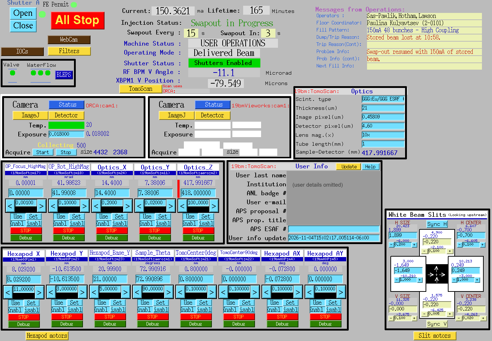
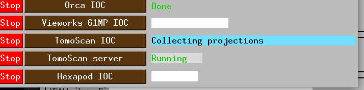
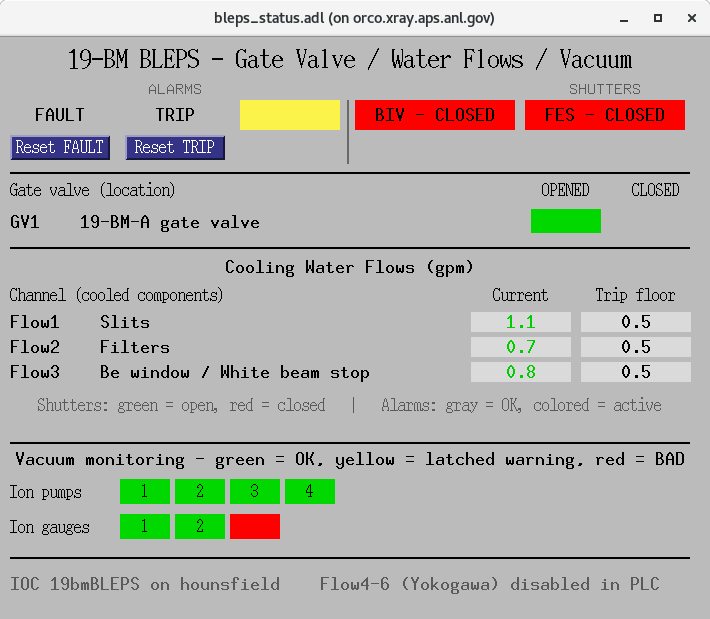
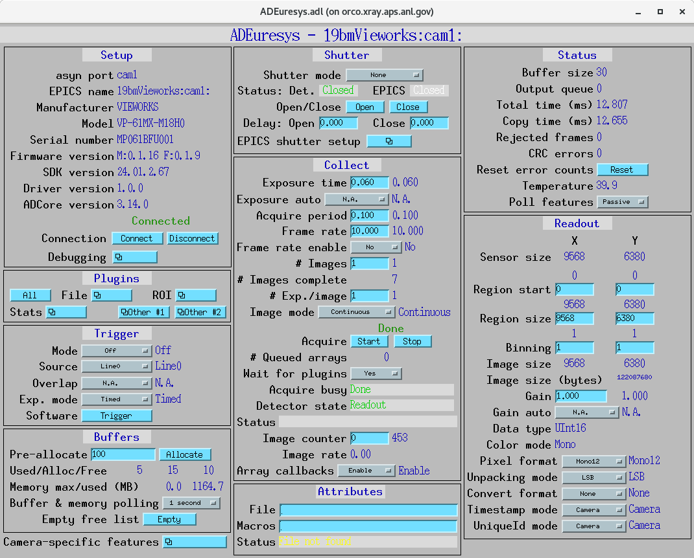
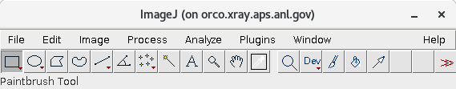
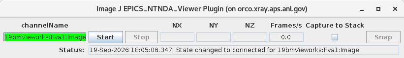
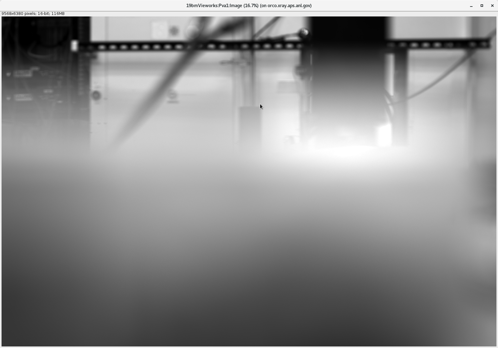

================
Beamline control
================

All beamline components and detectors are controlled using
`EPICS <https://epics-controls.org/>`_ and
`areaDetector <https://areadetector.github.io/master/index.html>`_.

Each device can be configured and controlled either through a graphical
user interface (GUI) or from Python using
`PyEpics <https://cars9.uchicago.edu/software/python/pyepics3/>`_.

To start the main 19-BM tomography control screen, run::

  [factuser@radon ~]$ start_tomo

It takes no arguments and changes nothing: it opens the screen and
exits. Both cameras appear on it -- see *Choosing the camera* below for
how the detector in use is selected.

.. note::

   At 2-BM a white field means the corresponding IOC is not running.
   **At 19-BM that is not always the case** — some panels are blank by
   design, because the hardware is not installed yet.

   Panels naming a real prefix — ``19bmSoft:``, ``19bmHXP:``, ``ORCA:``,
   ``19bmVieworks:``, ``19bm:TomoScan:``, ``19bm:BLEPS:`` — *should* be
   populated. If one of those is blank, the IOC behind it is down. Use
   the ``IOCs`` button to check, start or stop it.

   Two blanks are expected rather than faults. Only one camera IOC is
   normally running, so the other camera's panel is empty. And the ORCA
   serves no ``Proc1`` plugin, so the flat-field correction fields are
   blank whenever it is the selected camera.

.. note::

   **The screen can be opened on either ``radon`` or ``hounsfield``.**
   Both resolve every IOC reliably -- measured 2026-11-18, 14 of 14
   searches from each host for the camera, tomoScan and motor IOCs.

   This page previously said to use ``hounsfield`` only. That advice
   came from the detectors running on ``orco``, where two IOCs shared
   Channel Access port 5064 and unicast searches from the public network
   reached only one of them. The detectors now run on ``factdetector``
   on separate ports and the problem is gone.

   If panels do go blank, the first thing to check is the directory
   service rather than the IOCs::

       ssh hounsfield 'pgrep -a caDirServ'

Note that MEDM runs each button's command on whatever machine MEDM
itself is running on, so opening the screen on ``radon`` also puts
ImageJ and the image stream there. Full frames cross the network from
``factdetector``; if that ever becomes a bottleneck, opening the screen
on ``factdetector`` keeps the stream local to the camera.

DMagic's Data Management subcommands need ``/dm/19bm``, which is mounted
on ``radon`` -- see :doc:`../ops/item_003`.

What the screen provides
========================

.. list-table::
   :header-rows: 1
   :widths: 26 74

   * - Area
     - Contents
   * - Top left
     - Front-end shutter Open / Close with status, **All Stop**, and
       buttons for the ``IOCs`` screen and ``BLEPS``, alongside the
       BLEPS valve and water-flow indicators.
   * - Top right
     - APS machine status — ring current, lifetime, injection and
       swapout, operating mode, shutter status, and the Operations
       message board.
   * - Camera
     - Detector status and control, exposure, acquisition and frame
       size, with the camera's prefix shown at the top and a
       ``Scan uses`` readback of the camera tomoscan will actually
       drive. ``Detector`` offers both cameras; ``ImageJ`` opens the
       image viewer. Flat-field correction is Vieworks-only.
   * - User Info / Optics
     - ``19bm:TomoScan:`` metadata written into the data files.
   * - Bottom
     - Motor panels: the rotation stage, the four white-beam slit
       blades, the visible-optics stages and the six hexapod axes.
       ``Slit motors``, ``Hexapod motors`` and ``Filters`` open their
       own screens.

.. warning::

   The white-beam slit panels are full motor controls, not readouts.
   They drive the four blades of the 19-BM-A white-beam slits directly,
   and the same motors also sit behind the ``Slit1H`` / ``Slit1V``
   size-and-centre records, so a blade moved here changes those too.

IOCs
====

The ``IOCs`` button opens a small panel for starting and stopping the
software behind the screen:

One row per process. The wide button in the middle starts it, the red
``Stop`` on the left stops it, and the field on the right reports its
state:

.. list-table::
   :header-rows: 1
   :widths: 30 70

   * - Row
     - What it runs
   * - Orca IOC
     - The Hamamatsu ORCA Fire camera IOC, on ``factdetector``
   * - Vieworks 61MP IOC
     - The Vieworks VP-61MX camera IOC, on ``factdetector``
   * - TomoScan IOC
     - The tomoScan soft IOC, on ``factdetector``
   * - TomoScan server
     - The Python server that drives it — reads *Running* when up
   * - Hexapod IOC
     - ``19bmHXP`` on ``hounsfield``, driving the Aerotech Automation1.
       The IOC is in service; its **status field stays blank** because
       the record that field watches does not exist on this hexapod.
       Use ``softIOC Hexapod status`` to check it instead.

This is the panel to reach for when a field on the main screen is
blank and the prefix is a real one — see the note under the screenshot
at the top of this page for which blanks are expected and which are
not.

BLEPS
=====

The ``BLEPS`` button opens the equipment-protection status screen:

It shows the alarm summary and the front-end and beamline isolation
valve states, the 19-BM-A gate valve, the three cooling-water flows,
and the ion pumps and ion gauges. ``FAULT`` and ``TRIP`` can be
acknowledged here once the underlying condition has cleared.

See `BLEPS <https://img.xray.aps.anl.gov/source/internal/19bm/bleps.html>`__ for what BLEPS protects, the fault and trip
thresholds, and the full PV inventory.

.. note::

   Only the three ultrasonic flow channels are shown. The PLC also
   carries ``Flow4``..``Flow6``, a parallel Yokogawa set on the same
   three cooling services, but they are disabled and carry no
   interlock, so they are left off this screen.

Detector
========

The ``Detector`` button in the Camera panel offers both cameras.

**Vieworks VP-61MX** opens the ADEuresys screen:

**ORCA C16240** opens a screen built for that camera. The ORCA IOC is
not areaDetector -- it serves a subset of the usual records -- so the
screen carries what this camera does offer (sensor temperature and
cooler status, acquisition frame rate, trigger source, image flips) and
omits what it does not, including ``DetectorState``, ``StatusMessage``
and the statistics plugin.

Choosing the camera
===================

Which camera a scan uses is not a property of this screen: it is the
``19bm:TomoScan:CameraPVPrefix`` PV, read by the Python server when it
starts. The ``Scan uses`` field in the Camera panel shows it.

Both cameras are shown on the screen side by side. Only the selected
one displays values; the other reads white, which is expected rather
than a fault. A green outline marks the one in use.

**Changing it is a deliberate operation for the beamline scientist, not
something the screen does.** It means stopping whatever needs stopping,
setting ``CameraPVPrefix`` and ``FilePluginPVPrefix`` to the new camera,
restarting the tomoScan Python server so it re-reads them, and starting
whatever the new detector needs. ``start_tomo`` will not do any of this
-- it only opens the screen.

.. note::

   The flat-field fields are Vieworks-only. The ORCA serves no ``Proc1``
   plugin, so they stay blank whenever it is the selected camera. That
   is expected, not a fault.

.. warning::

   Changing the camera does not change the optics records.
   ``CameraObjective``, ``DetectorPixelSize`` and ``ImagePixelSize`` in
   the Optics panel are written into every data file and are **not**
   updated automatically. Check they describe the camera in use before
   collecting: the two cameras have different sensor pitches and sit
   behind different objectives, so a stale value puts a wrong pixel
   size into the file and from there into the reconstruction.

Viewing the live image
======================

The ``ImageJ`` button opens ImageJ:

Select **Plugins → EPICS_areaDetector → EPICS NTNDA Viewer**:

Set the channel name and press **Start**. The channel depends on the
camera: ``19bmVieworks:Pva1:Image`` for the Vieworks, or
``ORCA:image1:ArrayData`` for the ORCA.

.. note::

   The channel name is remembered between sessions, in
   ``~/EPICS_NTNDA_Viewer.properties``, so it normally comes up already
   set. The plugin only rewrites that file when it is closed through
   its own **Exit** button — quitting ImageJ or closing the image
   window does not save it.

.. important::

   Use the **NTNDA** viewer, not ``EPICS AD Viewer``. The two look
   similar but the plain AD viewer uses Channel Access, and one full
   Vieworks frame is 9568 x 6380 x 2 = 122 MB — larger than the Channel
   Access array limit in use here. pvAccess has no such limit, which is
   why the channel to open is ``Pva1:Image`` rather than ``image1``.
